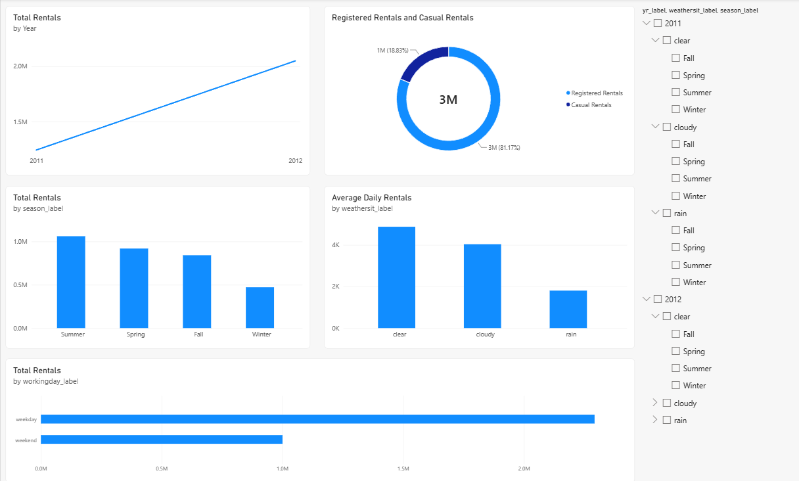

# bike-sharing-demand-analysis
Repository about analysis bike sharing demand by dataset from 
Hadi Fanaee-T
Laboratory of Artificial Intelligence and Decision Support (LIAAD), University of Porto
INESC Porto, Campus da FEUP
Rua Dr. Roberto Frias, 378
4200 - 465 Porto, Portugal

# Financial Performance Analysis

## Dashboard Preview

## Business Objective

Analyze total rentals by season, customer behaviour,
year trends, weather and weekday or weekend.

## Tools Used

- Microsoft Power BI
- Power Query
- DAX

## Key Findings

- Yearly trend: The demand of bike rentals significantly increased from 2011 to 2012.
- Seasonality: By season, in Summer most total of bike rentals higher than another season.
- Customer behavior: The most Customer in 81.17% registered for bike rentals meanwhile the casual slightly in 18.83% for just casual used.
- Working day: Mostly Used in weekday than weekend.
- Weather: Mostly in clear and cloudy weather for the total bike rentals, besides the rain weather impact significantly decrease the bike rentals.

## Recommendations

- Add more meaningful insights not just seeing the full of graph, but also can be use the slicer for filter more various kind of data, for example by the Product Paseo, Country Canada, and the year of 2014

## Files

- Power BI Dashboard
- PDF Report
- DAX Measures
- Data Dictionary

## License

Use of this dataset in publications must be cited to the following publication:

[1] Fanaee-T, Hadi, and Gama, Joao, "Event labeling combining ensemble detectors and background knowledge", Progress in Artificial Intelligence (2013): pp. 1-15, Springer Berlin Heidelberg, doi:10.1007/s13748-013-0040-3.

@article{
	year={2013},
	issn={2192-6352},
	journal={Progress in Artificial Intelligence},
	doi={10.1007/s13748-013-0040-3},
	title={Event labeling combining ensemble detectors and background knowledge},
	url={http://dx.doi.org/10.1007/s13748-013-0040-3},
	publisher={Springer Berlin Heidelberg},
	keywords={Event labeling; Event detection; Ensemble learning; Background knowledge},
	author={Fanaee-T, Hadi and Gama, Joao},
	pages={1-15}
}
